# oddgenes

A list of weird gene annotations or things that break bioinformatics assumptions

See also https://github.com/cmdcolin/oddbiology/ for more weird bio

Figures are reproduced from their original sources with attribution and keep
their original licenses; the text of this repo is CC0

## Gene structures

### 1bp length exon

Evidence for a 1bp exon in Arabidopsis, with competing splicing models discussed

http://www.nature.com/articles/srep18087

Another 1bp exon is discussed here
https://journals.plos.org/plosone/article?id=10.1371/journal.pone.0177959

Microexons in general are an interesting topic and are "involved in important
biological processes in brain development and human cancers" (ref
https://www.cell.com/molecular-therapy-family/nucleic-acids/fulltext/S2162-2531(23)00013-6)
yet are commonly misannotated (e.g. in plants
https://www.nature.com/articles/s41467-022-28449-8)

See also cryptic splice sites and exons, poison exons

### 0bp length exon

The phenomenon of recursive splicing can remove sequences progressively inside
an intron, so there can exist "0bp exons" that are just the splice-site
sequences pasted together.

"To identify potential zero nucleotide exon-type ratchet points, we parsed the
RNA-Seq alignments to identify novel splice junctions where the reads mapped to
an annotated 5' splice site and an unannotated 3' splice site, and the genomic
sequence at the 3' splice site junction was AG/GT"

https://www.ncbi.nlm.nih.gov/pmc/articles/PMC4529404/

Aberrant recursive splicing may contribute to disease
https://www.biorxiv.org/content/10.1101/2025.08.14.666599v1?med=mas

### Very large introns

Satellite DNA study uncovers megabase scale introns
https://www.biorxiv.org/content/early/2018/12/11/493254

An example in this paper kl-3 spans 4.3 million bp

In human, an example is Dystrophin. "Dystrophin is coded for by the DMD gene –
the largest known human gene, covering 2.4 megabases (0.08% of the human genome)
at locus Xp21. The primary transcript in muscle measures about 2,100 kilobases
and takes 16 hours to transcribe; the mature mRNA measures 14.0 kilobases"
https://en.wikipedia.org/wiki/Dystrophin

Transcribing introns this large is wasteful: the cell synthesizes megabases of
RNA and then splices nearly all of it back out. Dystrophin's 16-hour
transcription time also means a rapidly dividing cell cannot finish one
transcript before the next division interrupts it
https://pmc.ncbi.nlm.nih.gov/articles/PMC2754300/

### Large number of exons

Human TTN (titin) has ~364 exons, nearly double the runner-up NEB (nebulin) at
~184

https://www.ncbi.nlm.nih.gov/gene?Db=gene&Cmd=DetailsSearch&Term=7273

### Small introns

"A 2015 study suggests that the shortest known metazoan intron length is 30 base
pairs (bp) belonging to the human MST1L gene
(https://www.ncbi.nlm.nih.gov/pmc/articles/PMC4675715/). The shortest known
introns belong to the heterotrich ciliates, such as Stentor coeruleus, in which
most (> 95%) introns are 15 or 16 bp long
(https://www.ncbi.nlm.nih.gov/pmc/articles/PMC5659724/)"
https://en.wikipedia.org/wiki/Intron#Distribution

A novel splicing factor may be involved in small introns
https://www.news-medical.net/news/20240215/Novel-splicing-mechanism-for-short-introns-discovered.aspx

### Very large proteins

An alga described in 2024 encodes PKZILLA-1, a 4.7 megadalton protein with 140
enzyme domains
https://cen.acs.org/biological-chemistry/PKZILLA-proteins-smash-protein-size/102/web/2024/08

Human titin, the TTN product in muscle, is almost 4 megadaltons


The DMD gene above, despite being the largest known human gene (2.4 Mb), encodes
a ~427 kDa protein — large, but nowhere near megadalton scale. A shorter isoform
Dp71 (~71 kDa) is expressed in non-muscle tissues.
https://pmc.ncbi.nlm.nih.gov/articles/PMC49288/

### Loop-out exon skipping via inverted Alu repeats

Inverted Alu pairs flanking an exon can fold into an RNA stem-loop hairpin that
physically loops the exon out, causing skipping through RNA secondary structure
alone rather than splicing factors. ~707 human exons are affected, including
TBXT (linked to tail loss in hominoids).

https://academic.oup.com/nar/article/54/6/gkag196/8539533

### Backsplicing and circRNAs

Backsplicing circularizes RNAs, and alternative backsplicing yields different
circles from the same gene

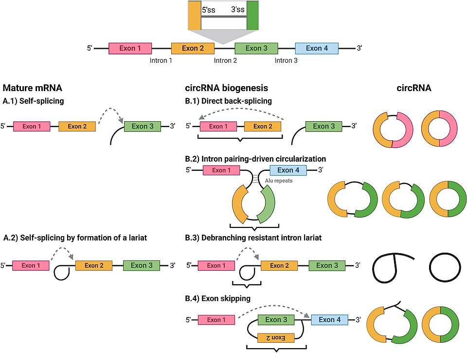

Figure from Dawoud et al. https://doi.org/10.1016/j.ncrna.2022.09.011

See https://academic.oup.com/nar/article/48/4/1779/5715065

### Very large number of isoforms in Dscam

"Dscam has 24 exons; exon 4 has 12 variants, exon 6 has 48 variants, exon 9 has
33 variants, and exon 17 has two variants. The combination of exons 4, 6, and 9
leads to 19,008 possible isoforms with different extracellular domains (due to
differences in Ig2, Ig3 and Ig4). With two different transmembrane domains from
exon 17, the total possible protein products could reach 38,016 isoforms"

Ref https://en.wikipedia.org/wiki/DSCAM
https://www.wikigenes.org/e/gene/e/35652.html

### Translational frameshift/Ribosomal frameshift/Programmed ribosomal frameshift

Ref https://en.wikipedia.org/wiki/Translational_frameshift

https://www.sciencedirect.com/topics/neuroscience/ribosomal-frameshifting

SARS-CoV-2 uses ribosomal frameshifting and this video shows a 3D animation of
the process, showing a 'pseudoknot' in the RNA contributes to it
https://www.youtube.com/watch?v=gLcueW61QMU

Another lecture explaining frameshift in viruses
https://youtu.be/b5BX5A3dGUQ?t=2980

In retroviruses like HIV, the gag and pol genes overlap in different reading
frames. A -1 ribosomal frameshift at a "slippery sequence" between them produces
the Gag-Pol fusion polyprotein at ~5% efficiency, while the other 95% of
ribosomes terminate at the gag stop codon and produce only Gag. This ratio is
critical — altering it is lethal to the virus. The Gag-Pol polyprotein is then
cleaved by the viral protease (which is itself part of the polyprotein) to
produce reverse transcriptase, integrase, and protease.

https://en.wikipedia.org/wiki/Gag-pol https://en.wikipedia.org/wiki/Pol_(HIV)

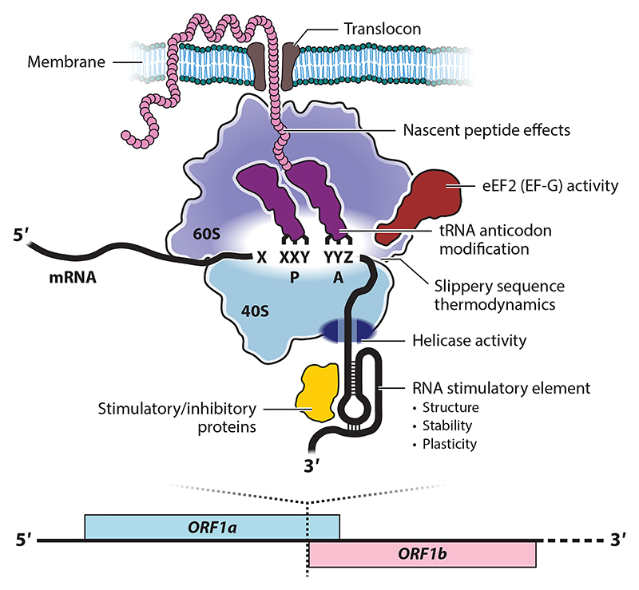

Figure from Atkins et al. (2016) showing the ribosome encountering a slippery
sequence (X XXY YYZ) and downstream RNA stimulatory element (pseudoknot) that
together promote -1 programmed ribosomal frameshifting
https://pmc.ncbi.nlm.nih.gov/articles/PMC7618472/

### Ribosome hopping

"Ribosome hopping involves ribosomes skipping over large portions of an mRNA
without translating them" Ref https://pubmed.ncbi.nlm.nih.gov/24711422/

The classic example is bacteriophage T4 gene 60, where the ribosome bypasses a
50-nucleotide coding gap — about half of ribosomes successfully make the hop
https://pmc.ncbi.nlm.nih.gov/articles/PMC107096/

### Internal Ribosome Entry Sites (IRES)

An IRES allows ribosomes to initiate translation at an internal position on an
mRNA without scanning from the 5' cap. This enables cap-independent translation
and is used by many viruses to hijack host ribosomes. Some cellular mRNAs also
contain IRES elements, allowing them to be translated under stress conditions
when cap-dependent translation is shut down.

https://en.wikipedia.org/wiki/Internal_ribosome_entry_site

### Stop codon readthrough/translational readthrough

"Stop codon suppression or translational readthrough occurs when in translation
a stop codon is interpreted as a sense codon, that is, when a (standard) amino
acid is 'encoded' by the stop codon. Mutated tRNAs can be the cause of
readthrough, but also certain nucleotide motifs close to the stop codon.
Translational readthrough is very common in viruses and bacteria, and has also
been found as a gene regulatory principle in humans, yeasts, bacteria and
drosophila. This kind of endogenous translational readthrough constitutes a
variation of the genetic code, because a stop codon codes for an amino acid. In
the case of human malate dehydrogenase, the stop codon is read through with a
frequency of about 4%. The amino acid inserted at the stop codon depends on the
identity of the stop codon itself: Gln, Tyr, and Lys have been found for the UAA
and UAG codons, while Cys, Trp, and Arg for the UGA codon have been identified
by mass spectrometry. Readthrough extent in mammals varies widely, and can
broadly diversify the proteome and affect cancer progression."

https://en.wikipedia.org/wiki/Stop_codon#Translational_readthrough

### Stop codon re-assignment

Two amino acids are encoded by codons that normally stop translation. The "opal"
(UGA) codon encodes selenocysteine https://en.wikipedia.org/wiki/Selenocysteine
in all domains of life, humans included: a stem-loop in the mRNA called a SECIS
element https://en.wikipedia.org/wiki/SECIS_element tells the ribosome to read
that UGA through, and the products are
[selenoproteins](https://en.wikipedia.org/wiki/Selenoprotein), of which the
human selenoproteome has 25 https://www.science.org/doi/10.1126/science.1083516

The "amber" (UAG) codon encodes pyrrolysine
https://en.wikipedia.org/wiki/Pyrrolysine in some archaea and bacteria but not
in humans, and needs only two genes to do it: pylT, an unusual tRNA with a CUA
anticodon, and pylS, the synthetase that charges it.

Several other stop codon modifications are described here
https://www.nature.com/articles/nrg3963

### Stop codons can be created by RNA editing

In mammalian apolipoprotein B, RNA editing introduces a premature stop codon
rather than removing one. The default unedited mRNA encodes the full-length B100
isoform (550 kDa). In the intestine, C-to-U editing at nucleotide 6666 converts
a glutamine codon (CAA) into a stop codon (UAA), producing the truncated B48
isoform (265 kDa). This is one of the best-characterized examples of RNA editing
altering protein output.

https://pubmed.ncbi.nlm.nih.gov/8409768/

### Ciliates with "No stop codons"

"Flexibility in the nuclear genetic code has been demonstrated in ciliates that
reassign standard stop codons to amino acids...Surprisingly, in two of these
species, we find efficient translation of all 64 codons as standard amino acids
and recognition of either one or all three stop codons"

Translation termination is therefore "context dependent" — determined by
surrounding sequence rather than just the 3-letter codon
https://pubmed.ncbi.nlm.nih.gov/27426948/

See also how Ciliates perform programmed DNA elimination (see that section) and
have some of the smallest known introns (see small introns section)

### Readthrough transcription

See also this Ensembl blog on annotating readthrough transcription which joins
multiple genes
http://www.ensembl.info/2019/02/11/annotating-readthrough-transcription-in-ensembl/

RNA-seq often makes a compelling case that two or more genes are joined by
splicing

Tools like mikado
https://academic.oup.com/gigascience/article/7/8/giy093/5057872 treat these as
artifactual fusions or chimeras, sometimes traceable to tandem duplication, but
they are very common in real data

### Non-canonical splice sites

The standard splice site is GT on the 5' end (donor) and AG on the 3' end
(acceptor), processed by the major (U2-type) spliceosome. Non-GT-AG sites exist:
GC-AG is the most common variant (~1% of introns) and is still handled by the
major spliceosome. A separate minor (U12-type) spliceosome handles a distinct
class of introns, originally identified by AT-AC termini but now known to also
include GT-AG introns with different internal sequences.

https://en.wikipedia.org/wiki/Minor_spliceosome

### Cryptic splice sites and cryptic exons

Cryptic splice sites resemble splice sites but go unused, until a mutation
disrupting the normal site or a shift in splicing factor levels activates them.
Deep intronic variants are a major source and account for a large fraction of
splice-disrupting events in genetic disease.

When two cryptic sites flanking a stretch of intron fire together, that stretch
is included as a cryptic exon, usually carrying a premature termination codon
that sends the transcript to nonsense-mediated decay. The degradation is what
makes them hard to see. In ALS/FTD, TDP-43 normally represses inclusion of
nonconserved cryptic exons, so when it is depleted from the nucleus they appear
in neuronal mRNAs like STMN2 and UNC13A
https://www.science.org/doi/10.1126/science.aab0983
https://www.nature.com/articles/s41586-022-04424-7

Review article https://academic.oup.com/nar/article/39/14/5837/1382796 and one
on the cryptic exon side
https://link.springer.com/article/10.1186/s13024-023-00608-5

Snaptron, from Ben Langmead's group, indexes huge amounts of public RNA-seq and
surfaces many kinds of cryptic splicing http://snaptron.cs.jhu.edu/, and
SpliceVault re-analyzes public RNA-seq to predict cryptic activation empirically
https://www.nature.com/articles/s41588-022-01293-8

See also poison exons

### Poison exons

Poison exons are conserved alternative exons that contain a premature
termination codon (PTC). When included via alternative splicing, the PTC
triggers NMD, degrading the transcript. Unlike cryptic exons which are
aberrantly activated, poison exons are a deliberate gene regulation mechanism:
cells fine-tune protein levels by adjusting the ratio of productive
(poison-exon-skipped) vs. NMD-targeted (poison-exon-included) transcripts.

Splicing factors like SR proteins and hnRNPs autoregulate their own levels via
poison exon inclusion. Therapeutically, ASOs that block poison exon inclusion
can upregulate expression of disease-relevant genes.

Review https://www.sciencedirect.com/science/article/pii/S0165614725000021

Poison exons in neurodevelopment and disease
https://pmc.ncbi.nlm.nih.gov/articles/PMC8042789/

### Exitrons

Exitrons (exonic introns) are internal regions within protein-coding exons that
can be spliced out like introns. When an exitron is retained it contributes to
the protein sequence; when spliced out it causes an in-frame deletion or
frameshift.

Exitron splicing is dramatically elevated in cancer: one study found 63% of
human coding genes are affected in tumors vs. 17% in normal tissue, and they can
generate tumor-specific neoepitopes
https://www.cell.com/molecular-cell/fulltext/S1097-2765(21)00223-9

Original paper defining exitrons https://genome.cshlp.org/content/25/7/995.full

### Wobble splicing

Repeats of the splice signal itself — NAGNAG at acceptors, GYNGYN at donors —
shift the chosen splice site by a few nucleotides

"Another mechanism introducing small variations to protein isoforms is wobble
splicing. Here, a GYN repeat at the donor splice site (5’ splice site; Y stands
for C or T and N stands for A, C, G, or T) or an NAG repeat at the acceptor
splice site (3’ splice site) leads to subtle length variations in the spliced
transcripts and finally to alternative isoforms differing in few amino acids."
ref https://onlinelibrary.wiley.com/doi/full/10.1002/bies.201900066?af=R

### Intron retention

Intron retention (IR) leaves intron sequence unspliced in the mature RNA. It
happens in both normal and disease conditions, and retained-intron transcripts
often undergo nonsense-mediated decay.

https://en.wikipedia.org/wiki/Alternative_splicing

Review: https://pmc.ncbi.nlm.nih.gov/articles/PMC12385487/

### Self-splicing RNA

Normally RNA is spliced by the spliceosome, a ribonucleoprotein complex where
the catalysis is actually performed by its RNA components (snRNAs). There is
also self-splicing RNA where the RNA catalyzes its own splicing without the
spliceosome

Group I introns use a free guanosine as a cofactor to catalyze their own
excision https://en.wikipedia.org/wiki/Group_I_catalytic_intron

Group II introns use a different mechanism (lariat formation, similar to
spliceosomal introns) and are thought to be evolutionary ancestors of the
spliceosome https://en.wikipedia.org/wiki/Group_II_intron

### Bulge helix bulge introns (archaeal tRNA)

Archaea (and some other organisms) splice tRNA introns whose ends fold into a
"bulge-helix-bulge" motif, cut by a tRNA splicing endonuclease rather than the
spliceosome

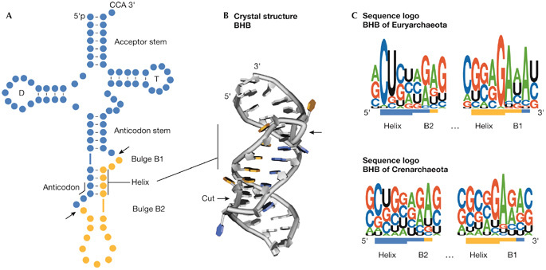

From https://www.embopress.org/doi/full/10.1038/embor.2008.101

The figure above shows that the orange part is excised as an intron for the tRNA

### Twintron

A twintron is an intron-within-an-intron. The internal intron must be spliced
first before the outer one can be recognized and spliced (if the internal one
does not need to be spliced first, it is simply called a nested intron).

See https://en.wikipedia.org/wiki/Twintron

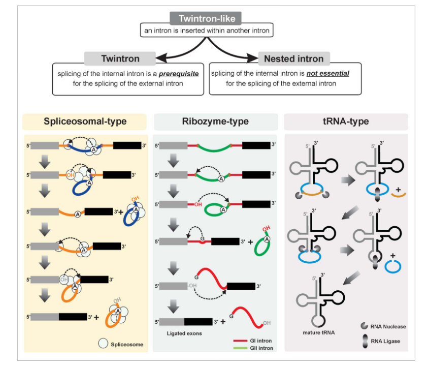

Figure from https://doi.org/10.1080/15476286.2015.1103427 showing twintron
conformations with a) spliceosomal introns b) group I/II self-splicing introns
and c) tRNA/bulge helix bulge type introns

### Introns in viruses

Introns were first discovered in adenoviruses (1977), not eukaryotes — a finding
that won Roberts and Sharp the Nobel Prize

https://en.wikipedia.org/wiki/Intron#Discovery_and_etymology (see also
https://www.proquest.com/docview/303935681/)

### Nuclear mitochondrial (NUMT) insertions

Pieces of the mitochondrial genome can be inserted into nuclear chromosomes in
eukaryotes. The human genome contains over 700 NUMTs. They confound
mitochondrial studies because PCR primers for mtDNA can accidentally amplify
NUMTs, and new insertions continue to occur — some are pathogenic.

https://en.wikipedia.org/wiki/Nuclear_mitochondrial_DNA_segment
https://pmc.ncbi.nlm.nih.gov/articles/PMC3228813/

### Untranslated regions

The 5' and 3' UTR (untranslated region) are parts of the mature mRNA that are
not translated into protein — the 5' UTR is before the start codon, the 3' UTR
is after the stop codon. Unlike introns, UTRs are retained in the final mRNA.
They are often targets of miRNA binding which can lead to degradation.

This blog post by Ensembl shows how they annotate UTR and a 19kb 3' UTR in
Grin2b
http://www.ensembl.info/2018/08/17/ensembl-insights-how-are-utrs-annotated/

### Polyadenylation

A poly-A signal (typically AAUAAA) directs cleavage of the pre-mRNA and addition
of ~200 adenines that are not encoded in the genome
https://en.wikipedia.org/wiki/Polyadenylation

A survey of poly-A using Oxford Nanopore found a transcript isoform with a 450bp
poly-A tail (ENST00000581230), with intron retention being a possible correlate
of longer poly-A tails
https://www.biorxiv.org/content/early/2018/11/09/459529.article-info

Polyadenylation normally happens after the last exon, but a poly-A signal
sitting inside an intron can be used instead — "intronic polyadenylation" (IpA).
That intronic position becomes the end of the transcript and everything
downstream, including the remaining exons, is lost, giving a shorter mRNA that
often encodes a truncated or nonfunctional protein. The name misleads: nothing
gets spliced away here, the intron is simply where transcription stops. The
classic example is immunoglobulin M — naive B cells use a downstream poly-A site
and make membrane-bound IgM, while activated B cells switch to an intronic site
and make the secreted form, a key step in the immune response
(https://pmc.ncbi.nlm.nih.gov/articles/PMC9715272/,
https://pubmed.ncbi.nlm.nih.gov/9885564/).

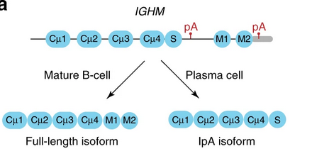

Figure showing "intronic polyadenylation" (IpA) creating a different isoform
from https://www.nature.com/articles/s41467-018-04112-z

In mammalian mitochondria, some mRNAs are polyadenylated immediately after a
genomically encoded U — the poly-A tail supplies the two A's needed to complete
a UAA stop codon. Without polyadenylation, these transcripts would lack a stop
codon entirely (noted in
https://www.ncbi.nlm.nih.gov/Taxonomy/Utils/wprintgc.cgi#SG2).

### Circular chromosomes

Circular chromosomes are routine for plasmids and prokaryotic genomes, but
annotation formats use linear coordinates, so anything wrapping past the origin
is awkward to represent.

While mitochondrial genomes are often assumed to be circular, some eukaryotes
have linear mitochondrial DNA — including certain yeasts (Candida) and some
plants and protists
https://www.sciencedirect.com/science/article/abs/pii/S0168952503003044

Most genome viewers handle this poorly. GFF represents it by letting a feature
end past the end of the sequence. Below the genome is 6407 bp long, but the CDS
runs past that and sets Is_circular=true

```
##gff-version 3.2.1
# organism Enterobacteria phage f1
# Note Bacteriophage f1, complete genome.
J02448  GenBank region  1      6407    .       +       .       ID=J02448;Name=J02448;Is_circular=true;
J02448  GenBank CDS     6006   7238    .       +       0       ID=geneII;Name=II;Note=protein II;
```

GFF3 specification:
https://github.com/the-sequence-ontology/specifications/blob/master/gff3.md

### Overlapping genes

Genes can overlap, either on opposite strands (sense-antisense) or on the same
strand in a different reading frame

https://en.wikipedia.org/wiki/Overlapping_gene

Some articles

- The novel EHEC gene asa overlaps the TEGT transporter gene in antisense and is
  regulated by NaCl and growth phase
  https://www.ncbi.nlm.nih.gov/m/pubmed/30552341/
- Overlapping genes in natural and engineered genomes
  https://www.nature.com/articles/s41576-021-00417-w
- Uncovering de novo gene birth in yeast using deep transcriptomics
  https://www.nature.com/articles/s41467-021-20911-3

Hepatitis B is an extreme example of overlapping genes — its ~3.2 kb genome
packs 4 overlapping reading frames, with every nucleotide belonging to at least
one gene https://pmc.ncbi.nlm.nih.gov/articles/PMC3126273/

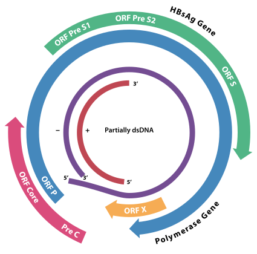

Figure from https://commons.wikimedia.org/wiki/File:HBV_Genome.svg

### Antisense transcription

Many genes produce transcripts from both strands of DNA at the same locus. Up to
70% of mammalian genes show evidence of antisense transcription. These natural
antisense transcripts (NATs) can regulate the sense gene through various
mechanisms https://www.nature.com/articles/nrm2738

The Xist/Tsix pair (see X chromosome inactivation section) is a well-known
example — Tsix is an antisense transcript that represses Xist on the active X

### Nested genes (genes within introns)

Entirely distinct genes can reside within the introns of larger genes,
transcribed independently and often from the opposite strand. The NF1 gene (~350
kb, 60 exons) has three genes inside its largest intron (intron 27b, ~60 kb),
all on the opposite strand:

- **OMGP** — oligodendrocyte-myelin glycoprotein, inhibits neurite outgrowth
- **EVI2B** — transmembrane glycoprotein required for granulocytic
  differentiation
- **EVI2A** — putative transmembrane protein involved in hematopoietic
  specification

None of them carry neurofibromatosis-causing mutations, and all are regulated
independently of NF1.

https://pmc.ncbi.nlm.nih.gov/articles/PMC359746/

### Upstream ORFs (uORFs)

Many mRNAs contain small open reading frames in their 5' UTR, upstream of the
main protein-coding ORF. These uORFs are translated by ribosomes before they
reach the main start codon, and can regulate translation of the downstream
protein — often by reducing its translation efficiency, but sometimes by
producing small functional peptides. About 50% of human mRNAs contain uORFs, yet
they are routinely ignored by gene annotation pipelines.

https://en.wikipedia.org/wiki/Upstream_open_reading_frame

## New genes

### Chimeric genes

Chimeric genes (also called gene fusions) are formed when parts of two or more
previously separate genes combine into a single new gene. This can happen
through several mechanisms: retrotransposition of an mRNA into or near another
gene, tandem duplication followed by fusion, unequal crossing-over between
paralogs, transposon-mediated capture of gene fragments, or even readthrough
transcription followed by retroposition. While many chimeric genes are
nonfunctional, some acquire novel functions and are positively selected.

The gene Jingwei is a chimera (or fusion) of two genes, alcohol dehydrogenase
and yellow emperor in Drosophila. Many chimeras are damaging but this has been
selected for. Remarkably, two other chimeric genes (Adh-Finnegan and Adh-Twain)
also independently derived from Adh via retroposition in different Drosophila
lineages -- parallel chimeric gene evolution from the same parent gene
http://www.pnas.org/content/101/46/16246
https://www.pnas.org/doi/10.1073/pnas.0503528102

Two Cytochrome P450 genes that don't confer any insecticide resistance on their
own but a chimeric P450 does https://pubmed.ncbi.nlm.nih.gov/22949643/

SDIC in Drosophila melanogaster is a chimera of annexin X and cytoplasmic dynein
intermediate chain that converted a cytoplasmic motor protein into a sperm-tail
motor protein by replacing the original functional domain. Present in ~10 tandem
copies on the X chromosome, it boosts sperm competition
https://www.nature.com/articles/25126

Sphinx is a chimeric gene formed by retroposition of an ATP synthase gene that
accumulated nonsense mutations and became a noncoding RNA. Despite losing all
coding potential, it regulates male courtship behavior in Drosophila -- knockout
causes increased male-male courtship
https://www.pnas.org/doi/10.1073/pnas.072066399

TRIMCyp is a fusion of TRIM5 and cyclophilin A created when L1
retrotransposition inserted CypA cDNA into TRIM5. The fusion protein restricts
HIV-1 infection. The same chimeric gene arose independently in both owl monkeys
and pigtailed macaques via separate retrotransposition events -- convergent
evolution at the gene-structure level
https://www.pnas.org/doi/10.1073/pnas.0404640101

The antifreeze glycoprotein (AFGP) gene in Antarctic notothenioid fish evolved
from a trypsinogen gene. The entire protein core was replaced by de novo
amplification of a 9-nucleotide repeat from a tiny element at the boundary of
trypsinogen's first intron. The resulting protein has zero sequence homology to
its parent gene https://www.pnas.org/doi/10.1073/pnas.94.8.3811

### Transposon-mediated chimeric genes

Transposons can capture fragments of host genes during excision or replication
and carry them to new genomic locations, creating chimeric genes. This
"transduplication" occurs across multiple transposon superfamilies and is a
major source of new genes, especially in plants.

Pack-MULEs in rice carry fragments from >1,000 genes, with ~23% fusing fragments
from multiple loci into chimeric ORFs. Also found in maize and the dicot Lotus
japonicus, suggesting this predates the monocot-dicot split
https://www.nature.com/articles/nature02953

Helitrons (rolling-circle transposons) are the main gene-capturing transposons
in animals, found in maize, bats, fungi, insects, and nematodes
https://www.nature.com/articles/ncomms10716

Gene capture has been observed in real time with Pack-CACTA elements in
Arabidopsis https://academic.oup.com/nar/article/47/3/1311/5198529

A broad survey found gene-capturing "Pack-TYPE" elements across all major DNA
transposon superfamilies (MULEs, CACTAs, Harbingers, hATs)
https://journals.plos.org/plosgenetics/article?id=10.1371/journal.pgen.1010078

## Trans-splicing, operons, and shared exons

### Adding leader sequence to mRNA

"About 70% of C. elegans mRNAs are trans-spliced to one of two 22 nucleotide
spliced leaders. SL1 is used to trim off the 5' ends of pre-mRNAs and replace
them with the SL1 sequence. This processing event is very closely related to
cis-splicing, or intron removal."

The region that is spliced out is called an outron

http://www.wormbook.org/chapters/www_transsplicingoperons/transsplicingoperons.html

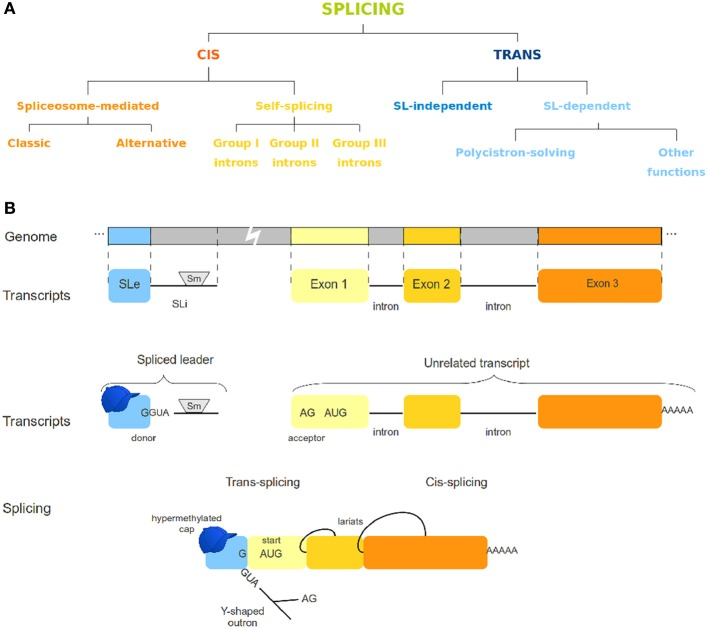

Figure from Lasda & Bhatt (2013)
https://pmc.ncbi.nlm.nih.gov/articles/PMC3795323/

The leader sequence only affects the untranslated region of the mRNA, so it does
not change the resulting protein.

This mechanism has evolved independently 10+ times across very different
organisms. In trypanosomes, 100% of mRNAs get a spliced leader added — it is the
only way to produce individual mRNAs from their polycistronic transcripts
https://royalsocietypublishing.org/doi/10.1098/rsob.190072

In dinoflagellates, all mRNAs also get a spliced leader
https://www.pnas.org/doi/10.1073/pnas.0700258104

The tunicate Oikopleura dioica is the only chordate known to use it
https://pmc.ncbi.nlm.nih.gov/articles/PMC507004/

Copepod crustaceans use it too (discovered 2015), even though insects and most
other arthropods do not https://www.nature.com/articles/srep17411

Also found in flatworms, rotifers, ctenophores, glass sponges, chaetognaths,
euglenids, and cryptomonads
https://academic.oup.com/mbe/article/27/3/684/1002183

The leader sequences are very similar within a phylum but totally different
between phyla, suggesting many independent origins
https://www.frontiersin.org/journals/genetics/articles/10.3389/fgene.2013.00199/full

The basal nematode Trichinella spiralis is an outlier — instead of the standard
SL1, it has at least 15 diverse non-canonical spliced leaders
https://pmc.ncbi.nlm.nih.gov/articles/PMC2271357/

### Polycistronic transcripts/operons

Although prevalent in bacteria, operons are not common in eukaryotes. However,
they are common in C. elegans specifically. "A characteristic feature of the
worm genome is the existence of genes organized into operons. These
polycistronic gene clusters contain two or more closely spaced genes, which are
oriented in a head-to-tail direction. They are transcribed as a single
polycistronic mRNA and separated into individual mRNAs by the process of
trans-splicing"

http://www.wormbook.org/chapters/www_overviewgenestructure.2/genestructure.html

Another paper says "Once considered rare in eukaryotes, polycistronic mRNA
expression has been identified in kinetoplastids and, more recently, green
algae, red algae, and certain fungi. This study provides comprehensive evidence
supporting the existence of polycistronic mRNA expression in the apicomplexan
parasite Cryptosporidium parvum"

https://www.biorxiv.org/content/10.1101/2025.01.17.633476v1.full.pdf

### Trans-splicing of exons on different strands

In C. elegans, transcripts from opposite strands, eri-6 and eri-7, are joined in
trans to make the eri-6/7 mRNA

https://pmc.ncbi.nlm.nih.gov/articles/PMC2756026/

### Exon shared across different genes

An example from drosophila, C. elegans, and rat shows a gene with a 5' exon
being shared between two genes

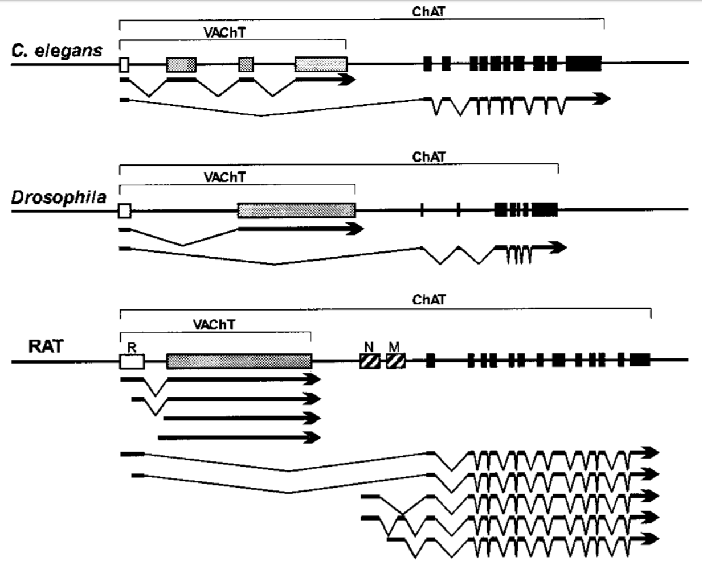

https://www.fasebj.org/doi/full/10.1096/fj.00-0313rev

An example here shows 5'UTR exons shared across different olfactory receptor
genes ("Some OR genes share 5'UTR exons")

https://www.biorxiv.org/content/biorxiv/early/2019/09/19/774612.full.pdf

**ANG** (angiogenin/RNASE5) and **RNASE4** share a non-coding first exon on
chr14q11.2, then diverge via alternative splicing into separate coding
sequences. Both are RNase A superfamily members; ANG is an angiogenic
ribonuclease with ALS-associated mutations. The shared-exon arrangement is
conserved in mouse.

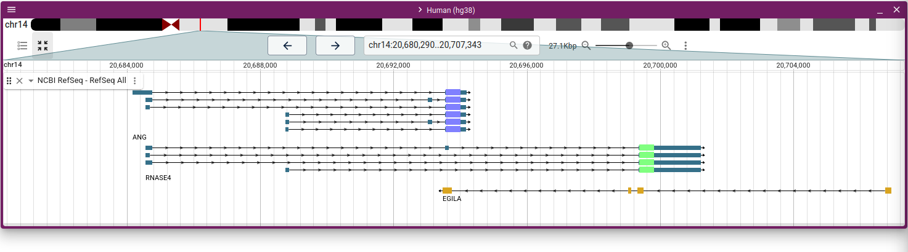

https://academic.oup.com/nar/article/33/3/1077/1064173 (Dyer & Rosenberg 2005)

## Evolution

A possible adaptive horizontal gene transfer from bacteria to a eukaryote: the
coffee berry borer beetle appears to have picked up a bacterial gene, and
domesticating it meant gaining a poly-A tail and losing the Shine-Dalgarno
sequence

https://www.ncbi.nlm.nih.gov/pmc/articles/PMC3306691/

also https://www.cell.com/cell/fulltext/S0092-8674(19)30097-2

## Codons

### Codon tables

Most organisms use the "standard genetic code", but alternative codes are common
across the tree of life — especially in mitochondria, ciliates, and mycoplasma.
The NCBI genetic code table lists these variants

https://www.ncbi.nlm.nih.gov/Taxonomy/Utils/wprintgc.cgi#SG31

One article explains how alternative genetic codes work
https://www.ncbi.nlm.nih.gov/pmc/articles/PMC6207430/

In vertebrate mitochondria, UGA codes for tryptophan instead of stop, and
AGA/AGG code for stop instead of arginine — a direct reversal of the standard
code https://www.ncbi.nlm.nih.gov/Taxonomy/Utils/wprintgc.cgi#SG2

The number of known alternative codes keeps growing — NCBI is currently up to
table 33, and computational screening of 250,000+ genomes (including
metagenome-assembled genomes) has found additional codes not yet officially
adopted https://elifesciences.org/articles/71402

### Alternative start codons

"The most common start codons for known Escherichia coli genes are AUG (83% of
genes), GUG (14%) and UUG (3%)"

"Here, we systematically quantified translation initiation of green fluorescent
protein (GFP) from all 64 codons and nanoluciferase from 12 codons on plasmids
designed to interrogate a range of translation initiation conditions."

https://www.sciencedaily.com/releases/2017/02/170221080506.htm

Testing in eukaryotes has also revealed alternative starts being viable
https://en.wikipedia.org/wiki/Start_codon#Eukaryotes

### 4-base/quaternary/quadruplet codons

3-base codon system is assumed by many, but engineered tRNAs can decode 4-base
codons with potential applications for using amino acids outside the 20
canonical ones

review https://elifesciences.org/articles/78869

evolving improved 4-base efficiency
https://www.nature.com/articles/s41467-021-25948-y

## Molecular

### Complex DNA structures

The standard right-handed double helix is B-DNA, but A-DNA and left-handed Z-DNA
also form. "There are also triple-stranded DNA forms and quadruplex forms such
as the G-quadruplex and the i-motif."
https://en.wikipedia.org/wiki/Nucleic_acid_double_helix
https://en.wikipedia.org/wiki/Triple-stranded_DNA

### Maxicircle architecture

Seen in trypanosomes. The kinetoplast DNA network contains two types of circles:
maxicircles (~20-40 kb) encode mitochondrial genes, but many of their
transcripts are "cryptogenes" — essentially unreadable without extensive RNA
editing. The guide RNAs that direct this editing are encoded on thousands of
minicircles (~1 kb each) in the same network. See also the RNA editing section.

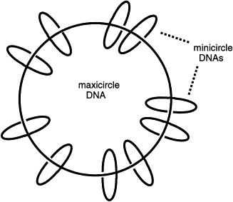

Figure from
https://www.sciencedirect.com/topics/agricultural-and-biological-sciences/kinetoplast-dna

https://pmc.ncbi.nlm.nih.gov/articles/PMC4835692/

### Fragmented mitochondrial genomes

Mitochondrial genomes are usually a single circular (or linear) molecule, but in
dinoflagellates they are broken into multiple small linear chromosomes (~6-10 kb
each). Only 3 protein-coding genes remain (cox1, cox3, cob), and even those are
split into fragments that must be separately transcribed and pieced together
https://academic.oup.com/mbe/article/24/7/1528/987488

### Polytene chromosomes and endoreplication

Some cells — famously insect salivary glands — copy their chromosomes through
repeated rounds of replication without cell division, giving giant banded
chromosomes https://en.wikipedia.org/wiki/Polytene_chromosome

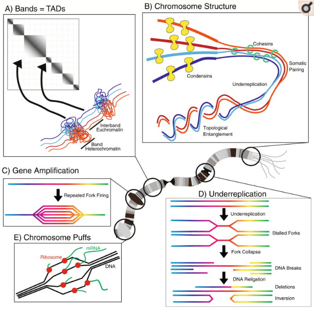

Figure source https://www.ncbi.nlm.nih.gov/pmc/articles/PMC5768140/

"Polytene chromosomes are produced by endoreplication, in which chromosomal DNA
undergoes repeated replication without cell division. Ten rounds of
endoreplication produces 2^10 = 1,024 DNA strands, which when arranged alongside
of each other produce distinctive banding patterns. Endoreplication occurs in
cells of the larval salivary glands of many species of Diptera, and increases
production of mRNA for Glue Protein that the larvae use to anchor themselves to
the walls of (for example) culture vials." from
https://www.mun.ca/biology/scarr/Polytene_Chromosomes.html

Endoreplication is not confined to salivary glands. Human liver and placenta
carry polyploid cells in an otherwise diploid organism, which is called
endopolyploidy https://www.ncbi.nlm.nih.gov/pmc/articles/PMC4442802/

It also shows up as a genome assembly problem: a PAG talk on the vanilla bean
genome reported heavy endoreplication driving very uneven sequencing coverage,
so the team picked the tissue samples with the least of it
https://plan.core-apps.com/pag_2023/abstract/e26dbeb1-df8f-4c57-a062-dcaf881b79f4

### Programmed DNA elimination

"While we commonly assume the genome to be largely identical across different
cells of a multicellular organism, a number of species undergo a developmental
regulated elimination process by which the genome in somatic cells is reduced,
while the germline genome remains intact. This process, called Programmed DNA
Elimination (PDE), affects a number of species including copepod crustaceans,
lamprey fish, single-celled ciliates and nematode worms (though not C.
elegans!)."

From ISMB2023 video "Deciphering developmentally programmed DNA elimination in
Mesorhabditis nematodes" https://www.youtube.com/watch?v=2x6ElKeISRY

Ciliates are the most extreme case — spirotrich ciliates like Oxytricha can
eliminate over 95% of their germline genome when building the somatic
macronucleus, including virtually all transposons. Even in Tetrahymena and
Paramecium, 20-30% of the germline genome is discarded
https://pmc.ncbi.nlm.nih.gov/articles/PMC3839606/

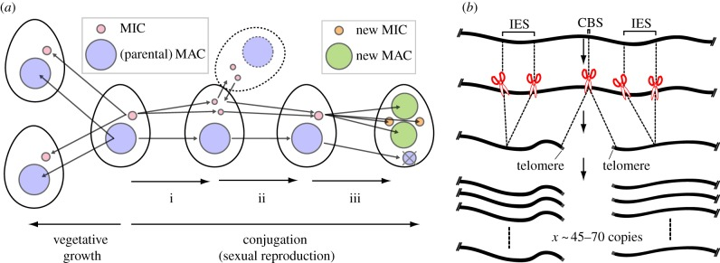

Figure from Noto & Mochizuki (2017)
https://pmc.ncbi.nlm.nih.gov/articles/PMC5666084/

See also the term "internal eliminated sequences" (IES)

Germline-restricted chromosomes (GRCs) are the same trick applied to a whole
chromosome: accessory chromosomes that occur only in germ cells and are
eliminated from somatic cells during embryo development, seen in several
unrelated animal taxa and inherited in strikingly non-Mendelian ways
https://pmc.ncbi.nlm.nih.gov/articles/PMC9508068/

PDE, GRCs, VDJ recombination and bacterial CRISPR spacer acquisition are all
cases of organisms editing their own genomes, reviewed in "How and when
organisms edit their own genomes"
https://www.nature.com/articles/s41588-025-02230-1

## Microchromosomes

Birds and most reptiles have a bimodal karyotype: a handful of large
macrochromosomes plus 20-30 tiny microchromosomes. Chicken is 2n=78, roughly 10
macro and 28 micro pairs. Microchromosomes are gene dense and GC rich, and they
recombine and evolve faster than the macrochromosomes. They look like the
ancestral vertebrate state, with mammalian lineages having fused most of them
into larger chromosomes.

https://www.pnas.org/doi/10.1073/pnas.2112494118

Short-read bird assemblies long left many microchromosomes fragmented or missing
entirely, so a "complete" genome could quietly omit a chunk of the gene catalog.

## B chromosomes

Supernumerary chromosomes that some individuals of a species carry and others do
not, known from thousands of plants, animals, and fungi. Most are
heterochromatic and gene poor, and many encode drive mechanisms that push their
own transmission above the Mendelian 50%.

Variable B counts inside a species are a practical trap for assembly: sequence
present in one individual and absent in another inflates apparent heterozygosity
and leaves regions collapsed or duplicated.

https://en.wikipedia.org/wiki/B_chromosome
https://doi.org/10.1007/s00018-013-1437-7

## Range of ploidy

Wikipedia's table of ploidy levels runs from haploid (male European fire ants)
through the familiar triploid seedless watermelons and hexaploid wheat, out to
tetratetracontaploid — forty-four sets — in black mulberry
https://en.wikipedia.org/wiki/Polyploidy#Types

## DNA modifications

There are many chemical modifications that can happen to DNA, leading to an
"extended alphabet" with functional changes.

The most common is 5mC, a methylated cytosine, usually in a CpG (a C followed by
a G). Others include 6mA and oxidized derivatives of 5mC such as 5hmC

Many other modifications exist, see https://dnamod.hoffmanlab.org/

## RNA world

### RNA editing

RNA editing changes the mRNA after transcription, so the sequenced RNA can
disagree with the genome. A-to-I editing is common in some species and reads out
as an A->G difference in RNA-seq with no corresponding genomic SNP.

Editing can also be conditional and tissue specific — see apolipoprotein B in
the stop codons created by RNA editing section

Other editing also occurs https://en.wikipedia.org/wiki/RNA_editing

In trypanosome mitochondria, extensive U-insertion/deletion editing can more
than double the length of some transcripts — the genomic sequence is essentially
a compressed template that is "decoded" by editing. The instructions for editing
come from guide RNAs encoded on minicircles in the kinetoplast DNA (see
maxicircle architecture section).
https://en.wikipedia.org/wiki/RNA_editing#Kinetoplastids

### Post-Transcriptional Exon Shuffling (PTES)

While the exon structure of most mRNAs follows the linear sequence of the
transcribed DNA, there are a few cases where mature mRNAs contain exons in a
non-linear order.

Al-Balool et al. (2011) validated several cases of PTES in human genes that are
evolutionarily conserved, including _MAN1A2_, _PHC3_, _TLE4_, and _CDK13_:
https://genome.cshlp.org/content/21/11/1788.short

### Lowly expressed RNA has large effects

The lncRNA VELUCT nearly escaped a lung cancer screen because its expression is
so low that it is "below the detection limit in total RNA from NCI-H460 cells by
RT-qPCR as well as RNA-Seq", however this study confirms it as a factor in
experiments (2025 note: this article has basically no citations, unclear whether
it actually is impactful)

https://www.ncbi.nlm.nih.gov/pubmed/28160600?dopt=Abstract

Note that X inactivation relies on relatively lowly expressed RNA also
https://twitter.com/mitchguttman/status/1454256452990734336

### X chromosome inactivation

X inactivation is a form of dosage compensation — equalizing X-linked gene
expression between XX and XY individuals. In mammals, one X in each female cell
is silenced early in development by Xist, a long non-coding RNA that spreads
along the chromosome in cis, recruiting silencing complexes. An antisense
transcript Tsix represses Xist on the active X.

Not all genes on the inactive X are silenced — about 15-25% of human X-linked
genes "escape" inactivation and are expressed from both copies. This is relevant
to bioinformatics because these escapee genes show biallelic expression in
females where you might expect monoallelic.

https://en.wikipedia.org/wiki/X-inactivation

https://www.youtube.com/watch?v=y3ST0whbA4k (great series from iBiology on X
chromosome inactivation)

See https://github.com/cmdcolin/oddbiology/ for calico cats, mosaicism, and how
different organisms solve dosage compensation in completely different ways

### tmRNA (transfer-messenger RNA)

tmRNA rescues bacterial ribosomes stalled on a truncated mRNA. One molecule
carries both a tRNA-like and an mRNA-like domain: it enters the ribosome as a
tRNA charged with alanine, and then the ribosome switches templates onto tmRNA's
own short ORF, which tags the stuck protein for degradation and supplies the
stop codon the broken message was missing. A single feature that is a tRNA and
an mRNA at once is not what most annotation formats expect.

https://en.wikipedia.org/wiki/Transfer-messenger_RNA

## Proteins

### Removal of start amino acid in proteins

Nearly every gene starts with a codon for methionine, but methionyl
aminopeptidase often removes that methionine after translation
https://en.m.wikipedia.org/wiki/Methionyl_aminopeptidase

### Micropeptides and small ORF-encoded peptides

Plenty of transcripts annotated as lncRNAs encode functional peptides under 100
amino acids, missed because annotation pipelines discard ORFs below an arbitrary
length cutoff. MOTS-c is stranger still: it is encoded inside the mitochondrial
12S rRNA gene, translated in the mitochondrion, and acts in the nucleus to
regulate the metabolic stress response.

https://doi.org/10.1016/j.cmet.2015.02.009 (MOTS-c)
https://doi.org/10.1038/nrm.2017.58 (review)

### Inteins

An intein is a segment of a protein that catalyzes its own excision after
translation, joining the flanking segments (exteins) together. Like introns for
RNA, but at the protein level. https://en.wikipedia.org/wiki/Intein

See section here
https://github.com/The-Sequence-Ontology/Specifications/blob/master/gff3.md#pathological-cases

### Polyprotein

Many viruses translate one long polyprotein and then cut it into pieces with a
protease. Coronaviruses reach the second half of theirs by ribosomal
frameshifting. Dengue and HIV use the same strategy

https://www.ncbi.nlm.nih.gov/pmc/articles/PMC6040172/
https://www.sciencedirect.com/science/article/abs/pii/S0959440X15000597

Some viruses use an alternative mechanism: 2A peptides cause the ribosome to
skip forming a peptide bond during translation, effectively splitting the
polyprotein without a protease. These are now widely used as a biotechnology
tool for expressing multiple proteins from one mRNA
https://pmc.ncbi.nlm.nih.gov/articles/PMC5438344/

## Transposons

Transposable elements make up ~45% of the human genome
(https://www.nature.com/articles/nature01262) and up to 85% of some plant
genomes like maize (https://www.science.org/doi/10.1126/science.1178534).

### Cross-species BovB transposon transfers

Or "How a quarter of the cow genome came from snakes"
http://phenomena.nationalgeographic.com/2013/01/01/how-a-quarter-of-the-cow-genome-came-from-snakes/

Source http://www.pnas.org/content/110/3/1012.full

### LINE1 important for embryonic development

The host normally silences LINE1 elements, but LINE1 transcription turns out to
matter for embryonic development.

https://www.ucsf.edu/news/2018/06/410781/not-junk-jumping-gene-critical-early-embryo

### Transposon-derived genes

The RAG1/RAG2 recombinase behind V(D)J recombination (see Immunity) derives from
an ancient Transib transposon, which makes the vertebrate adaptive immune system
a domesticated transposon https://www.nature.com/articles/nature03564

CENPB, which binds centromeric DNA, derives from a pogo-like transposase
https://www.nature.com/articles/384567a0

See also https://github.com/cmdcolin/oddbiology/ for syncytins and Arc
(retroviral elements co-opted for placental development and neuronal
communication)

## Immunity

### VDJ Recombination

VDJ recombination is a process of somatic DNA recombination in immune cells.

In bio 101 you learn: a gene is made of exons separated by introns, the cell
transcribes the gene into RNA, introns are spliced out, and the exons are joined
together in the mRNA. The DNA itself is never changed — every cell in your body
has the same genome.

VDJ recombination breaks this rule. The genome contains arrays of V (variable),
D (diversity), and J (joining) gene segments — many copies of each type,
arranged in tandem. Instead of just transcribing and splicing RNA, immune cells
physically cut the chromosomal DNA, join one V to one D to one J segment, and
delete the intervening DNA. Which segments end up joined is essentially random.
This is a permanent, irreversible change to the genome of that cell. The result
is a brand-new exon that didn't exist in the germline genome. Only then does
normal RNA splicing happen to join this newly assembled VDJ exon to the constant
region exons downstream — as Janeway's Immunobiology puts it: "To make a
complete immunoglobulin light-chain messenger RNA, the V-region exon is joined
to the C-region sequence by RNA splicing after transcription."

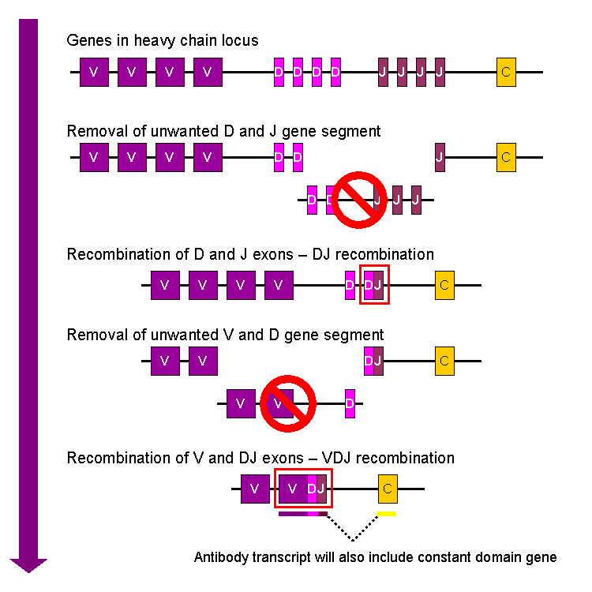

Figure from https://commons.wikimedia.org/wiki/File:VDJ_recombination.png

This is why V, D, and J are called "gene segments" rather than "exons" — they
are raw parts that must be assembled at the DNA level first, before the normal
exon-intron splicing machinery can do its job.

Flanking "recombination signal sequences" guide the joining, which is
deliberately imprecise — terminal transferase adds random nucleotides at the
junctions. A few dozen V, roughly two dozen D, and a handful of J segments per
locus therefore generate billions of different antibodies.

The rearrangement is called "somatic" because it happens in developing B and T
cells rather than the germline, so it is never passed to offspring. Elsewhere in
biology, recombination is a meiotic affair between homologous chromosomes. Here
a dedicated RAG1/RAG2 complex, itself derived from an ancient transposon (see
Transib above), cuts at the recombination signal sequences and leaves the broken
ends to the cell's general-purpose NHEJ (non-homologous end joining) repair
pathway — RAG supplies the targeted double-strand breaks and existing repair
machinery does the rest. Only lymphocytes express RAG, which is why only they
rearrange.

https://en.wikipedia.org/wiki/V(D)J_recombination
https://www.ncbi.nlm.nih.gov/books/NBK27140/

### MHC region

The MHC on chr6 is the most polymorphic region of the human genome — diverse
enough that hg38 ships extra alternative loci/contigs just to represent it

- https://en.wikipedia.org/wiki/Major_histocompatibility_complex

- https://en.wikipedia.org/wiki/Human_leukocyte_antigen

## Repeats

The "T2T" assembly of the maize Mo17 genome contains 235kb of nothing but TAG,
called out in the abstract because it is that silly

https://www.nature.com/articles/s41588-023-01419-6

## Structural variations

### Tandem duplication

A tandem duplication is a stretch of DNA copied immediately next to itself.
Where does it come from?

Mechanisms include

- replication slippage
- retrotransposition
- unequal crossing over (UCO)
- imperfect repair of double-strand breaks by nonhomologous end joining (NHEJ)
  (specifically generates 1-100bp range indels according to article)

Ref https://academic.oup.com/mbe/article/24/5/1190/1038942

### Segmental duplications

Segmental duplications (SDs) are blocks of DNA (1 kb to hundreds of kb) present
in two or more copies with >90% sequence identity. About 5-7% of the human
genome is segmentally duplicated. They are a major headache for genome assembly
— high identity causes collapsed or missing regions. T2T-CHM13 increased known
SD content from 167 Mbp (5.4%) to 218 Mbp (7.0%), accounting for nearly
one-third of newly assembled sequence.

https://www.science.org/doi/10.1126/science.abj6965

SDs serve as substrates for generating copy number variants (CNVs) via
non-allelic homologous recombination (NAHR): meiotic recombination between
paralogous copies instead of true alleles produces deletions, duplications, or
inversions. Other CNV mechanisms include NHEJ, FoSTeS/MMBIR (replication-based
template switching), and BFB cycles.

https://www.nature.com/articles/nrg2593

Medically important examples of NAHR between flanking SDs:

- **22q11.2 deletion** (DiGeorge) — most common human microdeletion (~1:3,000)
  https://pmc.ncbi.nlm.nih.gov/articles/PMC1310636/
- **CMT1A / HNPP at 17p12** — 1.5 Mb duplication (CMT1A) or reciprocal deletion
  (HNPP) affecting PMP22 dosage https://omim.org/entry/118220
- **SMA** — SMN1 loss in one of the most complex SD regions; most assemblies
  still don't correctly resolve SMN1/SMN2
  https://pubmed.ncbi.nlm.nih.gov/15470363/
- **Prader-Willi / Angelman at 15q11-q13** — same deletion, different syndrome
  depending on parent-of-origin (imprinting)
  https://pmc.ncbi.nlm.nih.gov/articles/PMC4449422/

### Complex structural variations in cancer

Cancer genomes harbor catastrophic rearrangements beyond simple deletions and
duplications:

- **Chromothripsis** — chromosome shattering and random reassembly in a single
  event, in >50% of some cancer types
  https://www.nature.com/articles/s41588-019-0576-7
- **Chromoplexy** — chains of balanced translocations across up to eight
  chromosomes, prevalent in prostate cancer (>60%)
  https://pmc.ncbi.nlm.nih.gov/articles/PMC3673705/
- **Chromoanasynthesis** — replication-based template switching producing
  localized duplications/triplications https://www.nature.com/articles/nm.2988
- **Extrachromosomal DNA (ecDNA)** — circular DNA (~1-5 Mb) replicating
  autonomously, driving oncogene amplification (EGFR, MYC) in ~17% of cancers.
  Lacks centromeres so segregates unequally
  https://www.nature.com/articles/s41576-022-00521-5
- **Breakage-fusion-bridge (BFB) cycles** — telomere loss causes sister
  chromatid fusion, anaphase bridge, and breakage, repeating to produce
  staircase amplification. Can trigger chromothripsis and ecDNA
  https://www.nature.com/articles/s41467-023-41259-w
- **Kataegis** — localized hypermutation clusters caused by APOBEC deaminases on
  single-stranded DNA at break sites https://elifesciences.org/articles/00534
- **Tyfonas, Pyrgo, Rigma** — novel complex SV classes: tyfonas (fold-back
  inversions, acral melanoma), pyrgo (tandem duplications, breast/ovarian),
  rigma (deletions at fragile sites, GI cancers)
  https://www.cell.com/cell/fulltext/S0092-8674(20)30997-1

## Pseudogenes

### A pseudogene that can protect against cancer in Elephants

Elephants carry many LIF copies, most of them pseudogenes. One of them, LIF6, is
switched back on by p53 and kills damaged cells — a "zombie gene" that may help
explain why such a large animal gets so little cancer

https://www.cell.com/cell-reports/fulltext/S2211-1247(18)31145-8

https://www.sciencealert.com/lif6-pseudogene-elephant-tumour-suppression-solution-petos-paradox

### Retrogenes (processed pseudogenes that came back)

When a retrotransposon reverse-transcribes an mRNA and pastes the copy back into
the genome, that copy has no introns and usually lands nowhere useful — a
processed pseudogene. Some pick up a promoter and become functional retrogenes
with an expression pattern of their own. GLUD2 is an intronless retrocopy of
GLUD1 that landed on the X chromosome in the hominoid lineage and is now
expressed in brain and testis. Paralogs, in other words, need not share an
intron-exon structure.

https://doi.org/10.1038/nrg2487 https://doi.org/10.1038/ng1431 (GLUD2)

## Regulation

### Intron mediated enhancement (IME)

Some intron sequences boost expression much the way promoters do
https://en.wikipedia.org/wiki/Intron-mediated_enhancement

The first intron of the UBQ10 gene in Arabidopsis exhibits IME, and "the
sequences responsible for increasing mRNA accumulation are redundant and
dispersed throughout the UBQ10 intron"
http://www.plantcell.org/content/early/2017/04/03/tpc.17.00020.full.pdf+html

The peppered moth's industrial melanism allele is a transposon insertion in an
intron of the cortex gene https://www.nature.com/articles/nature17951 (may not
be strictly IME, I'm personally not sure)

### Genomic imprinting

Imprinted genes are expressed from only one parental allele. In humans, ~100-200
genes are imprinted. Classic examples: IGF2 (paternal only) and H19 (maternal
only) share a regulatory region on chr11. The same chromosomal deletion at
15q11-q13 causes Prader-Willi syndrome if inherited from dad, or Angelman
syndrome if from mom.

https://en.wikipedia.org/wiki/Genomic_imprinting

### Bidirectional promoters

Wikipedia
https://en.wikipedia.org/wiki/Promoter_(genetics)#Bidirectional_(mammalian)

"Bidirectional promoters are a common feature of mammalian genomes. About 11% of
human genes are bidirectionally paired."

"The two genes are often functionally related, and modification of their shared
promoter region allows them to be co-regulated and thus co-expressed"

See also 'divergently paired genes'
https://academic.oup.com/gpb/article/23/4/qzaf058/8174973?login=false&utm_source=etoc&utm_campaign=gpb&utm_medium=email&nbd_source=campaigner&nbd=45398946253

## Sex chromosomes

### XX samples still have hundreds of thousands of reads on chrY

**TL;DR** — every XX sample carries reads on chrY. NA12878, a karyotypically XX
female, has 884,578 of them against an XY sample's 6,118,277: 14% of a real Y
rather than zero, and 190,158 of hers survive a `MAPQ >= 30` filter. They come
from sequence chrY shares with the rest of the genome — pseudoautosomal regions
byte-identical to chrX, the X-transposed region at ~99% identity to Xq21, and
beta satellite arrays. The measurement that does separate the two is depth
across the male-specific region: 0.48x the autosomal mean for XY against 0.015x
for XX.

Reads mapped to chrY are not evidence of a Y chromosome. NA12878 is a
karyotypically XX female sequenced to ~35x in the 1000 Genomes 30x collection,
aligned against an analysis-set GRCh38 that already hard-masks PAR on chrY.

Pick the wrong window and she is still indistinguishable from an XY sample. Give
both samples a reference that keeps chrY PAR and their PAR1 depth lands on top
of itself at one copy; inside a beta satellite array both pile up past 100x the
autosomal mean. Only sequence unique to a real Y pulls them apart.

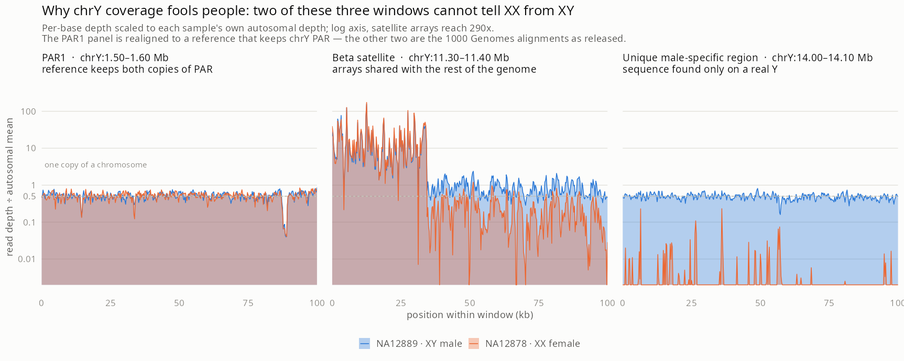

Three separate things put reads on chrY in an XX sample, and the ideogram shows
where each of them sits.

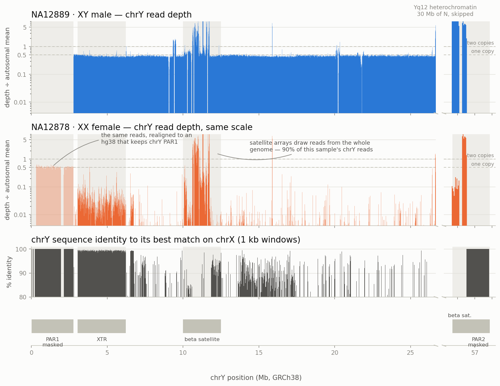

**The pseudoautosomal regions are the same sequence twice.** PAR1 and PAR2 sit
on both chrX and chrY, and in hg38 they are not merely similar, they are
byte-identical — 2,771,479 bp of PAR1 and 329,513 bp of PAR2 compared, zero
mismatching bases.

```bash
samtools faidx hg38.fa chrX:10001-2781479 | tail -n+2 | tr -d '\n' > parX
samtools faidx hg38.fa chrY:10001-2781479 | tail -n+2 | tr -d '\n' > parY
cmp parX parY   # identical
```

No aligner can split that. Pulling NA12878's PAR1 reads back out and remapping
them to an hg38 that keeps both copies, bwa-mem puts 286,511 on chrX and 284,437
on chrY and gives 99.93% of them MAPQ 0. The XY sample splits the same way,
362,977 and 361,699 with 99.92% at MAPQ 0. Half of either sample's PAR reads
land on chrY at full single-copy depth, so in PAR the two are the same picture.

Analysis-set references dodge this by hard-masking PAR on chrY. Uppercase the
UCSC hg38 chrY, N out chrY:10,001-2,781,479 and chrY:56,887,903-57,217,415, and
you reproduce the 1000 Genomes chrY byte for byte (md5
`ce3e31103314a704255f3cd90369ecce`). A pipeline pointed at a plain `hg38.fa`
gets no such protection.

**The X-transposed region is ~99% identical to Xq21.** Mapping hg38 chrY back
onto chrX in 1 kb windows finds it as a single block, chrY:3,050,000-6,234,000
against chrX around 89.4 Mb, left by a human-specific transposition of Xq21 to
Yp11.2. Masking PAR does nothing here.

**Satellite arrays collect strays from the whole genome.** 90% of NA12878's chrY
reads (797,492 of 884,578) sit in two blocks — chrY:10.0-12.5 Mb around the
centromere and chrY:56.67-56.89 Mb just proximal to PAR2 — both beta satellite
and `(ATTCC)n` arrays. The mates of those reads point at acrocentric satellite
contigs such as `chr14_GL000225v1_random` and `chrUn_GL000216v2`. A MAPQ filter
does not clean this up, because the array the reads came from is not in the
reference at all and bwa scores the surviving copy confidently: 96% of her
`MAPQ >= 30` chrY reads are in these same two blocks.

What separates XX from XY is depth across the male-specific region, not the
presence of chrY reads. Outside the satellite blocks NA12889 (XY) holds 0.48x
the autosomal mean flat across the whole MSY, while NA12878 sits at 0.015x, and
0.0014x once low-quality alignments are dropped. Artifact coverage is spiky and
local; a real Y is a continuous single-copy plateau.

https://academic.oup.com/gigascience/article/8/7/giz074/5530326

https://lh3.github.io/2017/11/13/which-human-reference-genome-to-use

### A mother's chrY reads look like her daughter's, not her son's

NA12878 has sons, and the Platinum Pedigree Consortium released DRAGEN
alignments of all of CEPH pedigree 1463 against GRCh38 and T2T-CHM13v2, so one
pipeline covers the whole family. A boy inherits his Y from his father, so
NA12878 and her sons share no Y sequence at all: her chrY reads are artifacts
and theirs are a real chromosome. Comparing the two read sets measures how
convincingly an artifact impersonates a Y — and kinship contributes nothing to
the answer.

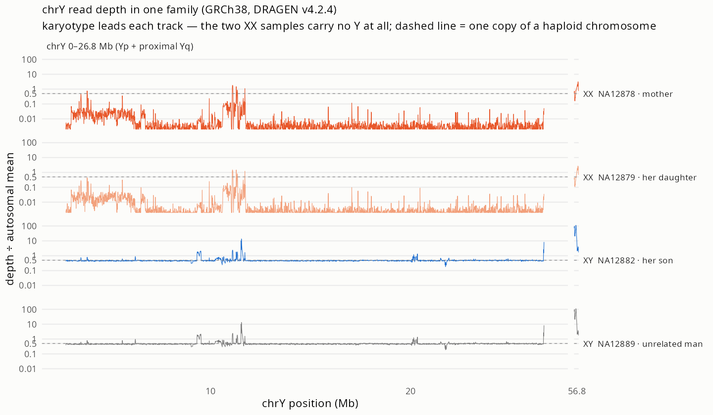

Three blocks hold 88% of NA12878's 156,293 chrY reads: the X-transposed region
(28,298 reads), the centromeric satellite at 10.0-12.5 Mb (61,572), and the 220
kb satellite block just proximal to PAR2 (48,351). Her sons pile into the same
three blocks, on top of a Y. Depth divided by the autosomal mean:

| region                     | NA12878 mother | NA12879 daughter | NA12882 son | NA12886 son | NA12889 unrelated man |
| -------------------------- | -------------- | ---------------- | ----------- | ----------- | --------------------- |
| X-transposed region        | 0.037          | 0.032            | 0.462       | 0.471       | 0.459                 |
| MSY, unique sequence       | 0.0039         | 0.0031           | 0.487       | 0.497       | 0.491                 |
| centromeric satellite      | 0.081          | 0.073            | 0.721       | 0.739       | 0.716                 |
| satellite proximal to PAR2 | 1.14           | 0.96             | 37.5        | 38.6        | 37.4                  |

Correlating 10 kb window profiles across chrY erases the family tree. Against
NA12878, Pearson r runs 0.25 for her son NA12882, 0.25 for her son NA12886, 0.24
for her husband NA12877 and 0.25 for the unrelated NA12889 — and 0.99 for her
daughter NA12879. Sex fixes the profile; relatedness does not move it.

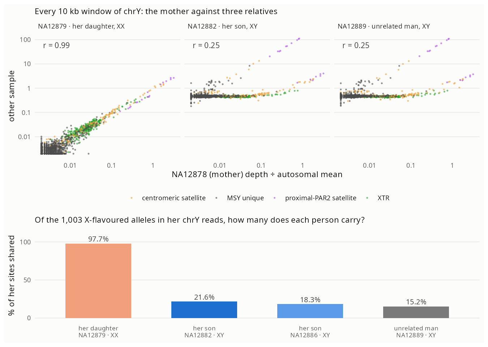

The alleles say where her reads came from. Inside the X-transposed region her
chrY reads disagree with the chrY reference at 1,003 positions covered at least
3x, and another XX individual — her daughter — carries 97.7% of those same
alleles. Her sons carry 21.6% and 18.3%, and an unrelated man 15.2%. Those
positions are fixed X-versus-Y differences, so a son's real Y lacks them while
any second X reproduces them.

Read for read the sequences are still nearly the same. Her chrY reads mismatch
the chrY reference at 0.95% of aligned bases in the X-transposed region and
0.91% across the MSY; her son's mismatch at 0.41% in both. One base in a hundred
separates an X-derived read from a Y-derived one, which is why no per-read
quality filter removes hers.

https://github.com/Platinum-Pedigree-Consortium/Platinum-Pedigree-Datasets

### A complete Y moves more chrY reads than a different person does

Swapping the reference changes NA12878's chrY read count by more than swapping
her for a man changes anything else. bwa-mem against the 1000 Genomes GRCh38
analysis set gives her 884,578 chrY reads; DRAGEN against the alt-masked
GRCh38DH graph gives 156,293; the same DRAGEN pipeline against T2T-CHM13v2 gives
71,519. Her son NA12882 goes the other way, 4,941,948 on GRCh38 against
5,906,736 on CHM13, because a complete Y is 5 Mb longer than one with a gap in
it. The female-to-male ratio falls from 14% to 3.2% to 1.2%.

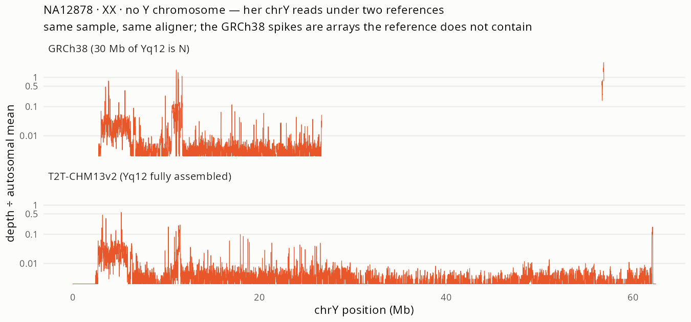

T2T removes the artifact by supplying the sequence the reads actually came from.
GRCh38 spells 30 Mb of Yq12 as N and has no beta satellite array long enough to
hold the reads that belong there, so they stack onto whatever short stub of
array the reference does contain — the 1.14x spike proximal to PAR2. CHM13v2
assembles those arrays in full, and her depth across the 38 Mb of Yq12 satellite
settles at 0.0027x the autosomal mean against her son's 0.368x. In euchromatic
MSY she sits at 0.0079x against his 0.5125x. No window on the T2T chrY makes her
look male.

The pseudoautosomal regions get worse, not better, under a real reference. Both
GRCh38 and the DRAGEN CHM13 reference hard-mask PAR on chrY, so the question
only arises once a reference keeps both copies. Take NA12878's 564,633 chrX PAR1
reads and map them to hg38 chrX+chrY: 282,259 land on chrX and 279,165 on chrY,
and fewer than 0.02% clear MAPQ 30, because the two copies are byte-identical
and the aligner reports the coin flip honestly. Map the same reads to
chrX_MATERNAL + chrY_PATERNAL from the HG002 v1.2 diploid assembly, where both
PARs are real, unmasked and genuinely different haplotypes: 267,848 go to chrX
and 293,756 to chrY, but now 17.5% and 18.9% clear MAPQ 30. A finished reference
does not resolve where a female's PAR reads belong; it just makes the aligner
confident about half of them.

https://github.com/marbl/HG002

## Chromosomal abnormalities

### Uniparental disomy (UPD)

A child can inherit both copies of a particular chromosome from one parent,
instead of the "usual" one copy from mom, one from dad

"UPD arises usually from the failure of the two members of a chromosome pair to
separate properly into two daughter cells during meiosis in the parent’s
germline (nondisjunction). The resulting abnormal gametes contain either two
copies of a chromosome (disomic) or no copy of that chromosome (nullisomic),
instead of the normal single copy of each chromosome (haploid). This leads to a
conception with either three copies of one chromosome (trisomy) or a single copy
of a chromosome (monosomy). If a second event occurs by either the loss of one
of the extra chromosomes in a trisomy or the duplication of the single
chromosome in a monosomy, the karyotypically normal cell may have a growth
advantage as compared to the aneuploid cells. UPD results primarily from one of
these “rescue” events"

https://www.ncbi.nlm.nih.gov/pmc/articles/PMC3111049/

### Mosaic loss of sex chromosomes

Older men can have a mosaic loss of the Y chromosome
https://en.wikipedia.org/wiki/Mosaic_loss_of_chromosome_Y

https://www.karger.com/Article/FullText/508564 (found from
https://www.biostars.org/p/9482437/)

may be associated with cardiac issues
https://www.science.org/doi/10.1126/science.abn3100

The same happens with the X in older women
https://www.cancer.gov/news-events/press-releases/2024/genetic-factors-predict-x-chromosome-loss

### Ring chromosome

In organisms with normally linear chromosomes, circular or "ring" chromosomes
can form from aberrant processes https://en.wikipedia.org/wiki/Ring_chromosome

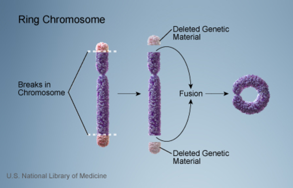

Figure from the National Library of Medicine
https://commons.wikimedia.org/wiki/File:NLM_ring_chromosome.jpg

There are also smaller fragments that can be circularized called "supernumerary
small ring chromosomes" (sSRC) or their linear counterparts, "supernumerary
small marker chromosomes" (sSMC)
https://en.wikipedia.org/wiki/Small_supernumerary_marker_chromosome

## File formats

### 0-based vs 1-based coordinates

Half the formats in bioinformatics count positions from 0 and half count from 1,
and they also disagree about whether the end coordinate belongs to the feature.

- 0-based, half-open: BED, BAM, BCF, 2bit, and the htslib/pysam APIs
- 1-based, closed: GFF3, GTF, SAM, VCF, wig, and the locstrings people type into
  genome browsers

The same feature is `chr1 100 200` in BED and `chr1 101 200` in GFF. Half-open
arithmetic is the nicer one to compute with — length is just end - start, and
abutting features share a number — but write it out as though it were 1-based
and every start shifts by one, an error small enough to survive review and large
enough to change a codon. samtools hands you both conventions at once: the
region strings on its command line are 1-based and closed, while the C API
underneath is 0-based and half-open.

https://genome-blog.gi.ucsc.edu/blog/2016/12/12/the-ucsc-genome-browser-coordinate-counting-systems/

R makes it funnier. R indexes vectors from 1, so Bioconductor's GRanges is
1-based closed throughout and lines up with GFF rather than BED. rtracklayer's
import() quietly adds 1 to every BED start and export() takes it back off again,
so the conversion is invisible right until you combine an imported GRanges with
coordinates you parsed yourself. Python, indexing from 0 and slicing half-open,
agrees with BED instead — so the same logic ported between the two languages
ends up off by one in whichever direction nobody checked.

https://bioconductor.org/packages/release/bioc/html/rtracklayer.html

### Non-ACGT letters in fasta files

The human genome as distributed by NCBI contains IUPAC ambiguity codes beyond
ACGTN https://www.bioinformatics.org/sms/iupac.html

Here is the incidence of non-ACGTN IUPAC letters in the entire human genome
GRCh38.p14 from
https://ftp.ncbi.nlm.nih.gov/refseq/H_sapiens/annotation/GRCh38_latest/refseq_identifiers/GRCh38_latest_genomic.fna.gz
(same for the "analysis set" files in
https://ftp.ncbi.nlm.nih.gov/genomes/all/GCA/000/001/405/GCA_000001405.15_GRCh38/seqs_for_alignment_pipelines.ucsc_ids/)

```
{
  'B' => 2,
  'K' => 8,
  'Y' => 36,
  'M' => 8,
  'R' => 29,
  'W' => 15,
  'S' => 5
};
```

Did you expect that in your bioinformatics software? Note that the mouse genome
(GRCm38.p5) as far as I could tell does not contain any non-ACGT IUPAC letters

See [count_fasta_letters.pl](count_fasta_letters.pl) for a script to count this.
The UCSC hg38.fa.gz does not have any non-ACGTN letters.

### rs SNP identifiers occurring in multiple places

Due to how dbSNP is created (based on alignments), an rs ID can occur in
multiple places on the genome https://www.biostars.org/p/2323/

### Weird characters in FASTA sequence names

In response to hg38 including a colon in sequence names, which conflicts with
commonly used representation of a range as chr1:1-100 for example (note:
SAMv1.pdf contains a regex to help resolve this), people analyzed meta-character
frequencies in sequence names https://github.com/samtools/hts-specs/issues/291

```
ENA
#   16927
*   1
,   231
-   122563947
.   521540419
/   236951
\   0
:   30181
;   72892
=   186611
@   3713
|   949

Reference sequences
 # 203
 % 203
 * 525
 + 1
 , 496
 - 154226
 . 1826561
 : 1577
 = 26
 _ 4961932
 | 1098333
```

There is a proposal to make commas illegal in FASTA names, since the SAM/BAM
supplementary alignment tag (SA) is itself comma separated

## Humongous chromosomes

Chromosomes keep outgrowing the formats built to hold them. Wheat chromosomes
average 806Mbp, past the 2^29-1 (~536Mbp) ceiling that the BAI/TBI binning
strategy imposes, which is why the CSI index format exists.

The axolotl goes further: individual chromosomes of 3.14 Gbp
https://genome.cshlp.org/content/29/2/317.long (2019), almost the size of the
whole human genome, and past the 2^31-1 (~2.14Gbp) limit on chromosome length in
BAM and CRAM, so bgzip/tabix SAM gets used instead (discussion
https://github.com/samtools/hts-specs/issues/655)

Bonus: I made a web tool to visualize BAI files and show how the binning index
works https://cmdcolin.github.io/bam_index_visualizer/

## Largest genomes

Just some honorable mentions for largest genome

- Polychaos dubium (formerly Amoeba dubia) - ~600-1300Gbp (unsequenced, 1968
  back of envelope measurement, needs confirmation)
  https://en.wikipedia.org/wiki/Polychaos_dubium (another ref
  https://bionumbers.hms.harvard.edu/bionumber.aspx?&id=117342)
- Dinoflagellates - up to 250Gbp (unsequenced, 1987 book referenced in this
  paper, needs confirmation, has weird chromosome "rod-like" structures)
  https://www.nature.com/articles/s41588-021-00841-y
- Tmesipteris oblanceolata (fork fern) - ~160Gb (unsequenced)
  https://www.nature.com/articles/d41586-024-01567-7
- Paris japonica (Japanese woodland herb) - ~149Gbp (unsequenced)
  https://en.wikipedia.org/wiki/Paris_japonica
- Tmesipteris obliqua (fern) - ~147Gbp (unsequenced) -
  https://en.wikipedia.org/wiki/Tmesipteris_obliqua
- South American lungfishes (Lepidosiren paradoxa) - ~91Gbp (sequenced)
  https://www.nature.com/articles/s41586-024-07830-1
- European mistletoe - ~90Gbp (sequenced)
  https://www.darwintreeoflife.org/news_item/2022-the-year-we-built-the-biggest-genome-in-britain-and-ireland/
- Antarctic krill - ~48Gbp (sequenced)
  https://www.cell.com/cell/pdf/S0092-8674(23)00107-1.pdf
- Neoceratodus forsteri (Australian lungfish) - ~43Gbp (sequenced)
  https://www.smithsonianmag.com/smart-news/australian-lungfish-has-biggest-genome-ever-sequenced-180976837/
  https://www.ncbi.nlm.nih.gov/genome/?term=Neoceratodus+forsteri
- Ambystoma mexicanum (axolotl) - ~32Gbp (sequenced)
  https://en.wikipedia.org/wiki/Axolotl
  https://www.ncbi.nlm.nih.gov/genome/?term=axolotl
- Allium ursinum (wild garlic) - ~30Gbp https://en.wikipedia.org/wiki/Onion_Test

Inspired by twitter thread
https://twitter.com/PetrovADmitri/status/1506824610360168455

Also see http://www.genomesize.com/statistics.php?stats=entire#stats_top

See also the plant C-value database, which is a measurement you will sometimes
see instead of base pair length https://cvalues.science.kew.org/ ("C-value is
the amount, in picograms, of DNA contained within a haploid nucleus")

## Smallest genomes

On the other end of the scale, some obligate endosymbionts have extremely
reduced genomes:

- Nasuia deltocephalinicola — ~112 kb, the smallest known cellular genome
  https://academic.oup.com/gbe/article/5/9/1675/555845
- Carsonella ruddii — ~160 kb
  https://www.science.org/doi/10.1126/science.1134196
- Mycoplasma genitalium — ~580 kb, used as the basis for "minimal genome"
  studies https://www.science.org/doi/10.1126/science.270.5235.397

Meanwhile, some giant viruses have genomes larger than these bacteria —
Pandoraviruses reach ~2.5 Mb, blurring the line between viruses and cellular
life https://www.science.org/doi/10.1126/science.1239181

## Humongous CIGAR strings

The CG tag stores CIGAR strings longer than 64k operations, since BAM holds
n_cigar_op in 16 bits. This concerns BAM only — CRAM stores the same information
differently, via reference based compression.

## Interesting gene names

As of Dec 2023 I extracted all the genes from a number of model organism
databases here https://cmdcolin.github.io/genes/

Some highlights from earlier work

- Tinman - "In mutant or knockout organisms, the loss of tinman results in the
  lack of heart formation" https://en.wikipedia.org/wiki/Tinman_gene
- Sonic hedgehog (SHH) - named after the video game character; hedgehog mutants
  have 'spiky' fruit fly embryos https://en.wikipedia.org/wiki/Sonic_hedgehog
- Robotnikin - a small molecule that blocks Shh signaling, so not a gene at all,
  named for Dr. Robotnik, the villain of the Sonic the Hedgehog franchise
  https://pmc.ncbi.nlm.nih.gov/articles/PMC2770933/
- Heart of glass (heg) - a zebrafish gene with mutant phenotype "Individual heg
  myocardial cells are also thinner than wild-type"
  https://www.ncbi.nlm.nih.gov/pubmed/14680629
- Dracula (drc) - "we isolated a mutation, dracula (drc), which manifested as a
  light-dependent lysis of red blood cells"
  https://www.ncbi.nlm.nih.gov/pubmed/10985389 (now renamed
  https://zfin.org/ZDB-GENE-000928-1)
- Sleeping Beauty transposon system -
  https://en.wikipedia.org/wiki/Sleeping_Beauty_transposon_system
- Skywalker (sky) -
  https://www.ncbi.nlm.nih.gov/gene?Db=gene&Cmd=DetailsSearch&Term=35359
- TIME FOR COFFEE (TIC) - "We characterize the time for coffee (tic) mutant that
  disrupts circadian gating, photoperiodism, and multiple circadian rhythms,
  with differential effects among rhythms"
  https://www.ncbi.nlm.nih.gov/gene?Db=gene&Cmd=DetailsSearch&Term=821807
- WTF - "Some alleles of the wtf gene family can increase their chances of
  spreading by using poisons to kill other alleles, and antidotes to save
  themselves." - https://www.ebi.ac.uk/interpro/entry/IPR004982
  https://www.sciencedaily.com/releases/2017/06/170620093209.htm
- Mothers against decapentaplegic - "it was found that a mutation in the gene in
  the mother repressed the gene decapentaplegic in the embryo. The phrase
  "Mothers against" was added as a humorous take-off"
  https://en.wikipedia.org/wiki/Mothers_against_decapentaplegic
- Saxophone (sax) - http://www.sdbonline.org/sites/fly/gene/saxophon.htm
- Beethoven (btv) - http://www.uniprot.org/uniprot/Q0E8P6
- Superman+kryptonite - https://en.wikipedia.org/wiki/Superman_(gene)
- Supervillin (SVIL) - https://www.uniprot.org/uniprot/O95425
- Wishful thinking (wit) - https://www.wikigenes.org/e/gene/e/44096.html
- Doublesex (dsx) - "The gene is expressed in both male and female flies and is
  subject to alternative splicing, producing the protein isoforms dsx_f in
  females and the longer dsx_m in males."
  https://en.wikipedia.org/wiki/Doublesex
- Fruitless (fru) - "Early work refers to the gene as fruity, an apparent pun on
  both the common name of D. melanogaster, the fruit fly, as well as a slang
  word for homosexual. As social attitudes towards homosexuality changed, fruity
  came to be regarded as offensive, or at best, not politically correct. Thus,
  the gene was re-dubbed fruitless, alluding to the lack of offspring produced
  by flies with the mutation.[10] However, despite the original name and a
  continuing history of misleading inferences by the popular media, fruitless
  mutants primarily show defects in male-female courtship, though certain
  mutants cause male-male or female-female courtship.[11]"
  https://en.wikipedia.org/wiki/Fruitless_(gene)
- Transformer (tra) - https://en.wikipedia.org/wiki/Transformer_(gene)
- Gypsy+Flamenco - https://www.ncbi.nlm.nih.gov/pmc/articles/PMC1206375/ also
  described in wiki
  https://en.wikipedia.org/wiki/Piwi-interacting_RNA#History_and_loci
- Jockey - http://flybase.org/reports/FBgn0015952.html
- Tigger - https://www.omim.org/entry/612972
- Nanog - named for Tír na nÓg, the land of the ever-young in Irish legend
  https://www.sciencedaily.com/releases/2003/06/030602024530.htm (source
  https://twitter.com/EpgntxEinstein/status/1057359656220348417)
- Jerky (jrk) - "A deficit in the Jerky protein in mice causes recurrent
  seizures" https://www.genecards.org/cgi-bin/carddisp.pl?gene=JRK
- Hippo (Hpo) - https://www.wikigenes.org/e/gene/e/37247.html
- Dishevelled (Dsh) - https://en.wikipedia.org/wiki/Dishevelled
- Glass bottom boat (gbb) - "fruit fly larvae with a faulty glass bottom boat
  gene are transparent"
  https://www.thenakedscientists.com/articles/interviews/gene-month-glass-bottom-boat
  http://www.sdbonline.org/sites/fly/dbzhnsky/60a-1.htm
- Makes caterpillars floppy (mcf) - https://www.pnas.org/content/99/16/10742
  (source https://twitter.com/JUNIUS_64/status/1081007886560608256)
- Eyeless http://flybase.org/reports/FBgn0005558.html
- Straightjacket (stj) - http://flybase.org/reports/FBgn0261041.html
- Huluwa http://science.sciencemag.org/content/362/6417/eaat1045 ref
  https://twitter.com/zhouwanding/status/1065960714978897921
- frameshifts or pseudogene? - check sequence -
  https://www.ncbi.nlm.nih.gov/gene/?term=24562233%5Buid%5D
- Bad response to refrigeration (brr)
  https://twitter.com/hitenmadhani/status/1149471071675924481?s=20
- Mindbomb (mib1) - https://www.sdbonline.org/sites/fly/hjmuller/mindbomb1.htm
- β'COP http://flybase.org/reports/FBgn0025724.html
  (https://twitter.com/DarrenObbard/status/1260613447198412800)
- King-tubby https://www.uniprot.org/uniprot/B0XFQ9 see also tubby
  https://www.uniprot.org/uniprot/P50586
- fucK https://www.uniprot.org/uniprot/?query=fuck&sort=score
- scarecrow
  https://academic.oup.com/g3journal/article/15/5/jkaf055/8071394?login=false&utm_source=etoc&utm_campaign=g3journal&utm_medium=email
- Halloween genes (spook, disembodied, phantom, shadow, shade)
  https://en.wikipedia.org/wiki/Halloween_genes
- VANDAL21
  https://www.arabidopsis.org/servlets/TairObject?type=transposon_family&id=139
- HotDog domain - superfamily of genes/proteins
  https://www.wikidata.org/wiki/Q24785143
  https://www.ebi.ac.uk/interpro/entry/IPR029069
- Flower/fwe - https://flybase.org/reports/FBgn0261722.html
- Brahma https://www.sdbonline.org/sites/fly/polycomb/brahma.htm
- Pokemon gene - "The Pokémon Company threatened MSKCC with legal action in
  December 2005 for creating an association between cancer and the media
  franchise, and as a consequence MSKCC is now referring to it by its gene name
  Zbtb7" - Pokemon/pikachu/zubat (story
  https://bsky.app/profile/c0nc0rdance.bsky.social/post/3k6w3gwtell2j)
- Bring lots of money (blom7α)
  https://www.ncbi.nlm.nih.gov/pmc/articles/PMC2781463/
  https://www.uniprot.org/uniprotkb/Q7Z7F0/entry
- MAGOH - Drosophila flies produce unfit progeny when they have mutations in
  their mago nashi (Japanese: 孫なし, Hepburn: mago nashi,
  lit. 'grandchildless') gene. The progeny have defects in germplasm assembly
  and germline development https://www.uniprot.org/uniprotkb/P61326/entry
- IGL@ - a locus containing many immunoglobulin genes, but why the @ sign?
  https://en.wikipedia.org/wiki/IGL@
- Spooky toxin - https://en.wikipedia.org/wiki/Ssm_spooky_toxin
  (https://twitter.com/depthsofwiki/status/1712555421918245242)
- Always early (aly) - http://flybase.org/reports/FBgn0004372.html
- Lonely guy (LOG) - https://onlinelibrary.wiley.com/doi/full/10.1111/pbi.13783
- PKZILLA (very large gene) -
  https://www-science-org.libproxy.berkeley.edu/doi/10.1126/science.ado3290
- Dachshund (dac) "plays a role in leg development" (in flies)
  https://en.wikipedia.org/wiki/Dachshund_(gene)
- Blanks ("Loss of Blanks causes complete male sterility")
  https://www.pnas.org/doi/10.1073/pnas.1009781108
- LUMP (and with a p-element insertion p-lump)
  https://pmc.ncbi.nlm.nih.gov/articles/PMC3166160/
- loquacious
  https://www.ncbi.nlm.nih.gov/gene?Db=gene&Cmd=DetailsSearch&Term=34751
- TOPLESS https://pmc.ncbi.nlm.nih.gov/articles/PMC2643930/
- hemingway https://www.ncbi.nlm.nih.gov/gene/42207
- RAVER2 https://www.ncbi.nlm.nih.gov/gene/?term=Homo+sapiens+RAVER2
- ARSE https://www.ncbi.nlm.nih.gov/gene/100627778
- XXX https://www.ncbi.nlm.nih.gov/gene/1260943
- LAZY
  https://www.frontiersin.org/journals/plant-science/articles/10.3389/fpls.2020.606241/full
- BABY BOOM https://pubmed.ncbi.nlm.nih.gov/30298388/
- fiz/fezzik - "embryos and adult flies completely lacking CG9509 are unusually
  large - hence renaming it after the gentle giant Fezzik" (from the movie The
  Princess Bride) https://flybase.org/reports/FBgn0030594.html
  https://www.thenakedscientists.com/articles/science-features/gene-month-fezzik
- Shavenbaby https://en.wikipedia.org/wiki/Shavenbaby see also polished rice
  (pri)
- DAD - defender against death https://www.ncbi.nlm.nih.gov/gene/1603
- Hang (hangover) - https://www.alliancegenome.org/gene/FB:FBgn0026575
- pickpocket (ppk) - https://flybase.org/reports/FBgn0020258.html

### Allele names

Sometimes it is not the gene, but the allele that is named

- Bad hair day http://www.informatics.jax.org/allele/MGI:3764934
- Samba, chacha, bossa nova http://www.informatics.jax.org/allele/MGI:3708457
- Yoda http://www.informatics.jax.org/allele/MGI:3797584

Ref https://twitter.com/hmdc_mgi/status/1242893531779391496

## More reading

A long list of RNA types https://en.wikipedia.org/wiki/List_of_RNAs, and
circular RNA in particular https://en.wikipedia.org/wiki/Circular_RNA

Tables of RNA modifications, whose links keep rotting:
https://www.hindawi.com/journals/jna/2011/408053/tab1/ used to point at
http://mods.rna.albany.edu/mods/, which is also dead, so try
http://genesilico.pl/modomics/modifications

Maternal RNAs deposited in the egg stay active in the zygote and can have
transgenerational effects
https://en.wikipedia.org/wiki/Maternal_to_zygotic_transition

Interesting PDB entries, from the molstar repo
https://github.com/molstar/molstar/blob/master/docs/docs/misc/interesting-pdb-entries.md

Great illustrations of interesting biology, including information about gene
names https://twitter.com/vividbiology

Many of the stories behind fly gene nomenclature are collected at
https://web.archive.org/web/20110716201703/http://www.flynome.com/cgi-bin/search?source=browse
including the famous ForRentApartments dot com gene (just kidding but lol
https://web.archive.org/web/20110716202150/http://www.flynome.com/cgi-bin/search?storyID=180)

Musing article: "What is in a (gene) name?"
https://web.archive.org/web/20180731060319/https://blogs.plos.org/toothandclaw/2012/06/17/whats-in-a-gene-name/

## Send PRs for more things!
